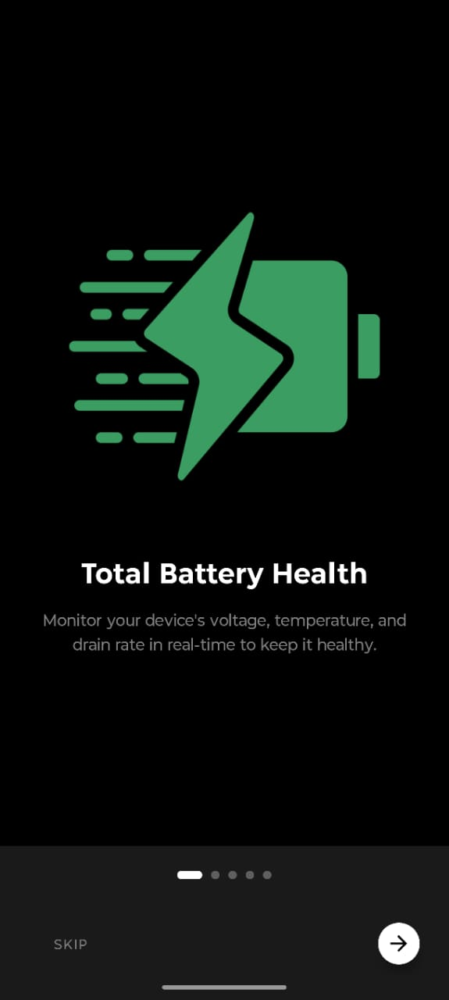
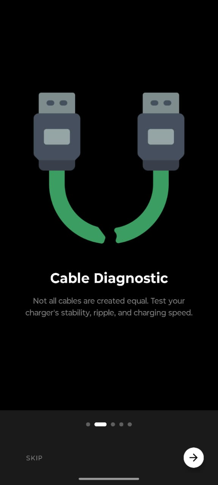
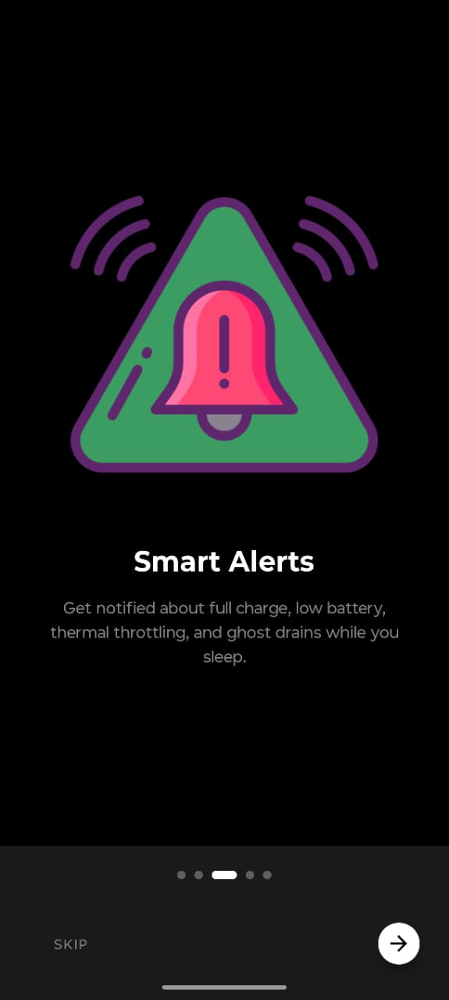
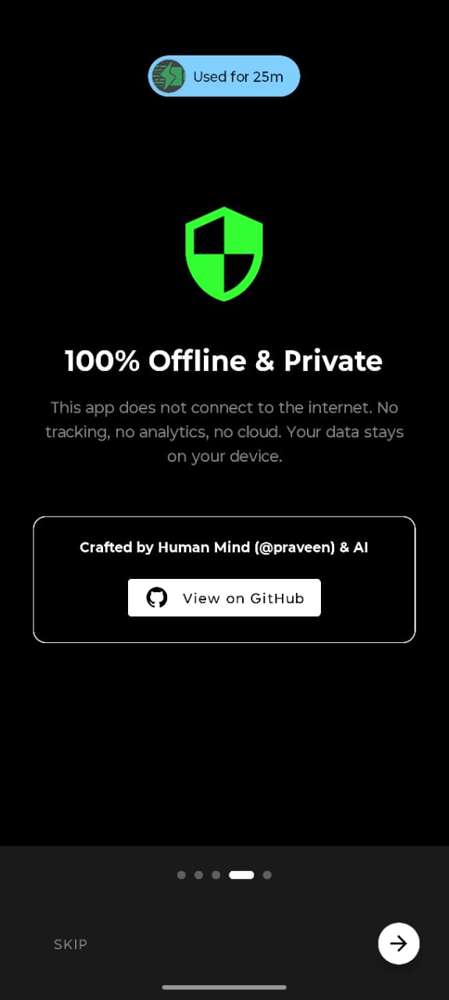
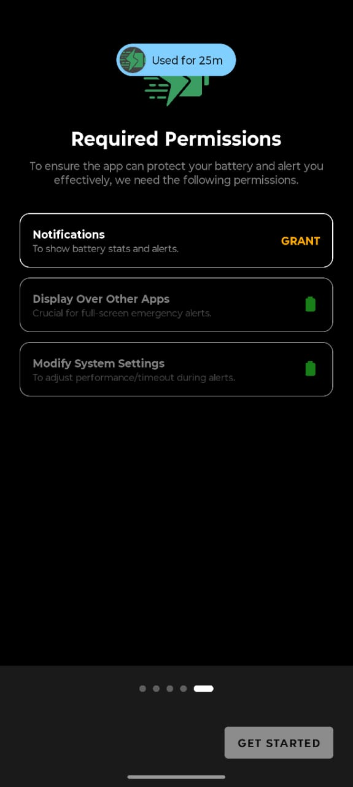
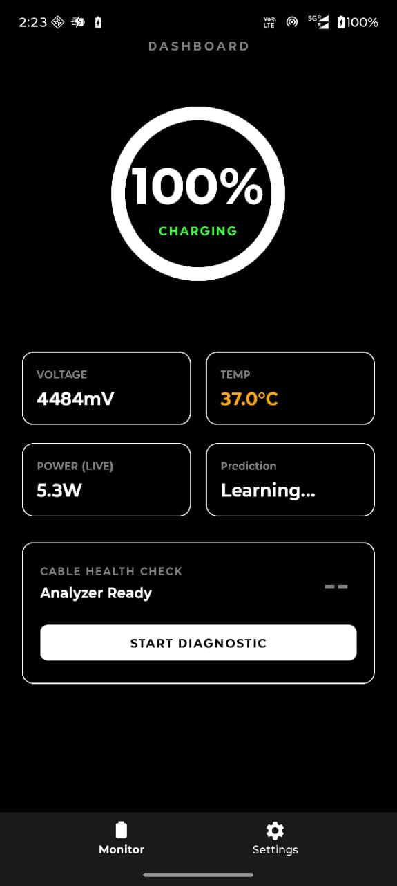
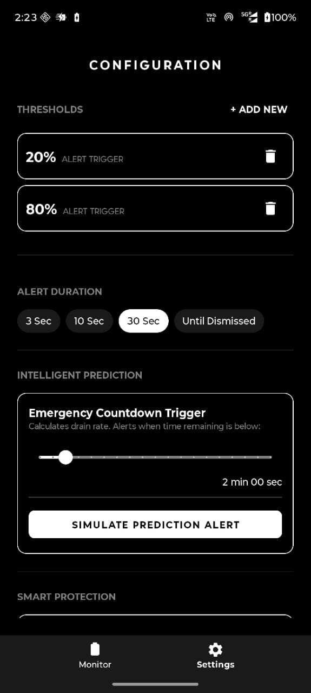

# 🔋 AIO Battery Monitor

Privacy-minded Android battery monitoring with local telemetry, charging diagnostics, predictions, and configurable alerts. The application is written in Kotlin and uses XML layouts; battery data and settings are processed on the device.

> Audited from the production branch at commit d0af8d4 (tag v1.0.5) on August 18, 2026.

## What it does

- Shows battery percentage, charging state, voltage, temperature, live power, and an estimated time to full or empty.
- Runs a foreground monitoring service and attempts to recover after boot, task removal, or service termination.
- Raises configurable percentage alerts and emergency countdown overlays.
- Detects high temperature, background drain while the screen is off, and low-battery bedtime conditions.
- Benchmarks a connected charger/cable for approximately 10 seconds and reports average/max wattage, voltage ripple, stability, score, grade, and charging type.
- Stores thresholds, alert preferences, and battery history locally with DataStore and Room.
- Provides onboarding for notifications, overlay access, system settings, and battery-optimization exemptions.

## Privacy and data behavior

The app does not declare android.permission.INTERNET, and the dependency graph contains no analytics or advertising SDK. Battery calculations, preferences, and history are local.

The app does include buttons that open the project page in the device's external browser. That browser activity is outside the app's offline data path and may use the network. Also note that android:allowBackup="true" is enabled and the backup/data-extraction XML files do not exclude application data; Android backup behavior therefore follows platform defaults. The current code should not be described as a strict “no cloud backup” guarantee without changing those manifest and backup rules.

## Features and implementation

| Area | Current implementation |
| --- | --- |
| Dashboard | DashboardFragment polls battery state while resumed and renders percentage, status, voltage, temperature, watts, and prediction text. |
| Prediction | PredictionEngine combines local history/regression with BATTERY_PROPERTY_CURRENT_NOW and a Kalman-style filter; it falls back to weighted history when sensor data is unavailable. |
| Cable diagnostic | CableBenchmarkEngine requires charging, warms up for 2 seconds, samples for 8 seconds, and scores stability, throughput, and voltage ripple. |
| Monitoring | BatteryMonitorService listens for battery/screen events, posts an ongoing notification, checks thresholds, thermal state (42°C), ghost drain, bedtime reminders, and emergency prediction. |
| Alerts | OverlayService renders full-screen overlays and can drive sound, vibration, and camera-flash strobe based on saved preferences. AlertActivity also contains TTS support. |
| Persistence | PreferencesManager uses Preferences DataStore; AppDatabase/BatteryDao store battery history with Room. |
| Recovery | BootReceiver starts monitoring after boot; RestartReceiver is used by exact-alarm watchdog and service-restart paths. |

Thresholds default to 20% and 80%, with a maximum of five entries. Alert duration options are 3 seconds, 10 seconds, 30 seconds, or until dismissed.

## Technology and requirements

- Kotlin 2.0.21
- Android Gradle Plugin 8.13.1 and Gradle 8.13
- Android SDK compile/target 36; minimum SDK 24
- JDK 17 for the Gradle/Android toolchain; the module's Java/Kotlin source target is 11
- XML layouts with View Binding, AndroidX Navigation, Material Components, Coroutines/Flow, Hilt, Room, Preferences DataStore, Gson, and Glide
- A physical Android device is strongly recommended for current/voltage readings, charger benchmarking, overlays, boot behavior, and background-service checks.

## Build and run

~~~powershell
git clone https://github.com/prvn2004/batteryreminder.git
cd batteryreminder

# Debug APK
.\gradlew.bat assembleDebug

# Install on a connected device
.\gradlew.bat installDebug
~~~

Open the project in Android Studio with an Android SDK 36 installation, allow Gradle sync to finish, and run the app configuration. On first launch, complete onboarding and grant the permissions required by the features you want to use.

## Tests and verification

~~~powershell
# JVM unit tests
.\gradlew.bat testDebugUnitTest

# Instrumented tests on an emulator or connected device
.\gradlew.bat connectedDebugAndroidTest
~~~

The repository currently contains the default sample tests only: one arithmetic unit test and one package-name instrumentation test. There are no feature-specific automated tests for prediction, cable scoring, alerts, or service recovery. Physical-device verification is still required for battery sensors, exact alarms, overlay permissions, notifications, boot receivers, and OEM background restrictions.

During the August 18, 2026 documentation audit, Gradle verification could not be started in the audit environment because no usable JDK was installed (JAVA_HOME pointed to a missing Android Studio JBR). This is an environment blocker, not a passing test result.

## Release builds and CI

The production workflow in .github/workflows/release.yml runs on pushes to production. It uses JDK 17, sets BUILD_NUMBER from the GitHub Actions run number, builds both the APK and AAB, tags the release as v1.0.<run-number>, and publishes the artifacts to a GitHub Release.

For a local release build, the module reads these environment variables:

| Variable | Purpose |
| --- | --- |
| BUILD_NUMBER | Version code and the 1.0.<number> version name; defaults to 1 locally. |
| KEYSTORE_PATH | Keystore path; defaults to release-key.jks. |
| KEYSTORE_PASSWORD | Keystore password. |
| KEY_ALIAS | Signing key alias. |
| KEY_PASSWORD | Signing key password. |
| CI | Set to true in CI so the signing configuration is populated from injected secrets. |

~~~powershell
.\gradlew.bat assembleRelease bundleRelease
~~~

Never commit a keystore, signing password, or other release secret.

## Project layout

~~~text
app/src/main/java/project/aio/batteryreminder/
├── data/        # DataStore, Room entities/DAO/database, models
├── di/          # Hilt modules
├── service/     # Foreground monitor and boot/restart receivers
├── ui/          # Activities, fragments, onboarding, settings, overlays
└── utils/       # Prediction, cable benchmark, alerts, logging, OEM helpers
app/src/main/res/
├── layout/      # XML screens and reusable views
├── navigation/  # Navigation graph
├── values/      # Strings, colors, themes
└── xml/         # Backup/data-extraction rules
.github/workflows/release.yml
~~~

## Screenshots

The repository includes the following onboarding, dashboard, and settings screenshots under assets/:

| | | |
|:---:|:---:|:---:|
|  |  |  |
|  |  |  |
| |  | |

## Known limitations and follow-up work

- Battery current and charge-counter values vary by device; some hardware reports zero or unsupported values, so prediction includes fallbacks and should be treated as an estimate.
- Exact alarms, notification delivery, overlay windows, write-settings access, and battery-optimization exemptions are user- and OEM-dependent.
- Android backup is currently enabled by the manifest defaults; decide whether to keep that behavior or explicitly exclude sensitive local data.
- The repository does not currently contain a LICENSE file. Contribution and redistribution terms should be made explicit before presenting the project as MIT-licensed or otherwise broadly licensed.
- Feature-specific automated coverage is still needed, especially around service recovery, alert timing, prediction accuracy, and cable benchmark edge cases.

## Contributing

See [CONTRIBUTING.md](CONTRIBUTING.md) for the development workflow, coding expectations, and device-testing checklist.
